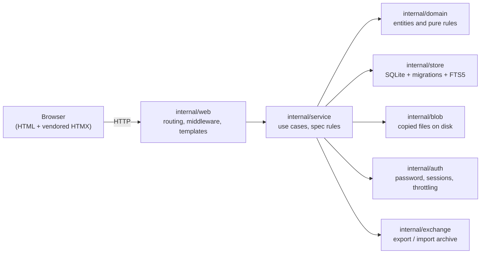
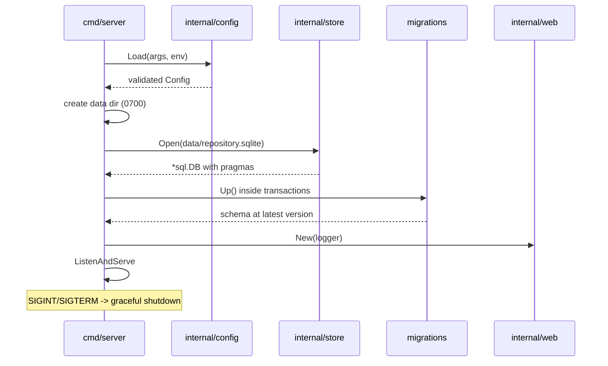
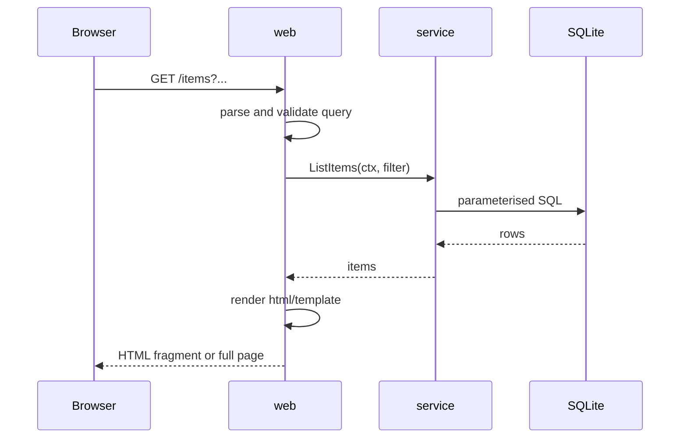

# Architecture overview

This page shows how Trove is put together, which package owns what, and how a
request flows through the system. It is the starting point before reading the
[data model](data-model.md), [storage](storage.md), [search](search.md),
[security](security.md) and [performance](performance.md) pages.

## Goals

- One self-contained binary, one data directory, one user.
- Boring, standard-library-first Go. No framework, no ORM, no build step for
  front-end assets.
- The spec rules are the source of behaviour; this document only describes
  structure.

## Components

Dependency rules (`AGENTS.md` section 4.2):

- `domain` imports nothing from this project.
- `service` declares the interfaces it needs; `store`, `blob`, `auth` and
  `exchange` implement them. `service` never imports `web` or `database/sql`.
- `web` handlers only parse input, call a service and render a template.
- Wiring happens in `cmd/server/main.go`; there is no global mutable state.

## Packages

| Package | Responsibility | State at M0 |
|---|---|---|
| `cmd/server` | Configuration, wiring, startup and graceful shutdown. | Implemented. |
| `internal/app` | Product name and build information. | Implemented. |
| `internal/config` | Flags and environment variables, validated at startup. | Implemented. |
| `internal/store` | SQLite connection, pragmas, migration runner, item/tag/attachment SQL and FTS building. | Implemented through M4. |
| `internal/web` | HTTP routes, middleware, templates, security headers. | Auth screens and `/healthz`; item UI arrives in M2. |
| `internal/domain` | Entities, validation and pure rules. | Implemented (items, tags, attachments, query types). |
| `internal/service` | Use cases implementing spec rules. | Item and tag use cases implemented. |
| `internal/blob` | Streaming, hashing and atomic storage of copied files. | Implemented. |
| `internal/auth` | Argon2id, sessions, login throttling. | Implemented. |
| `internal/exchange` | ZIP export and restore-only import. | Implemented. |

Empty packages are deliberately not created ahead of time: a milestone creates
them when it has code and tests to put in them.

## Startup sequence

## Request flow (from M2)

HTMX requests return the same HTML fragments as normal navigation, so every
action also works with plain links and forms.

## Startup guarantees

- Configuration is validated before anything is created or opened.
- The data directory is created with mode `0700`; the database file is created
  with mode `0600`.
- Migrations run in transactions and never edit history.
- The HTTP server has no read/write timeouts because uploads stream with no
  size cap (spec `N-1`); only `ReadHeaderTimeout` and `IdleTimeout` are set.

## Related pages

- [Data model](data-model.md)
- [Storage](storage.md)
- [Search](search.md)
- [Security](security.md)
- [Performance](performance.md)
- [Development guide](../guides/development.md)
